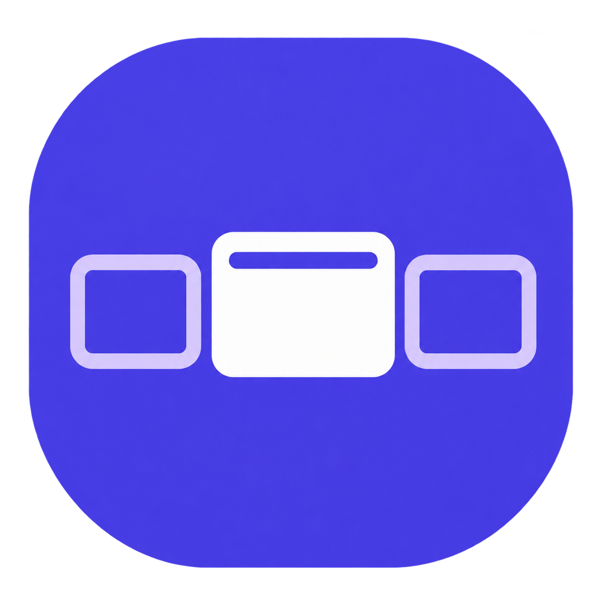
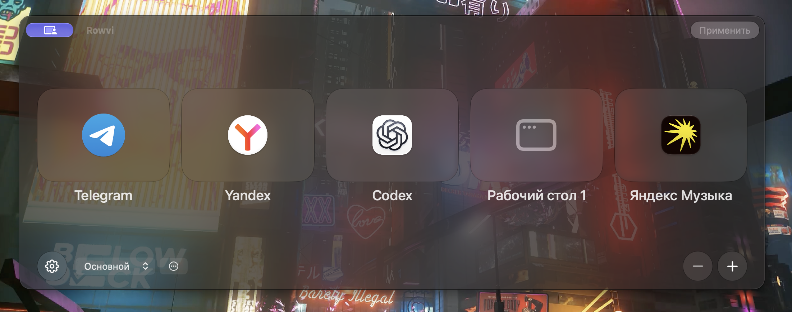

<div align="center">
  
  <h1>Rowvi</h1>
  <p><strong>Профили рабочих столов и окон для macOS</strong></p>
  <p>Соберите раскладку для работы, учёбы или личных задач и переключайтесь между профилями из строки меню.</p>
  <p>
    <a href="#установка">Установка</a> ·
    <a href="#быстрый-старт">Быстрый старт</a> ·
    <a href="#сборка-из-исходников">Сборка</a> ·
    <a href="LICENSE">MIT</a>
  </p>
  
</div>

## Возможности

- **Профили.** Для каждого профиля задайте свой набор рабочих столов, приложений и режимов окон. Профили можно создавать, дублировать, переименовывать и удалять.
- **Рабочие столы.** Добавляйте столы и меняйте их порядок перетаскиванием плиток.
- **Режимы окон.** Выбирайте обычное окно или разворот на весь рабочий стол. Для рабочего стола с одним окном доступен режим отдельного полноэкранного пространства.
- **Строка меню и автозапуск.** Переключайте профили из строки меню, скрывайте иконку в Dock и выбирайте, какой профиль применять при запуске Rowvi.

## Установка

**Требуется macOS 27 или новее.**

1. На странице [GitHub Releases](https://github.com/ditarget/rowvi/releases) скачайте `Rowvi-v*.dmg`, если он есть в последнем релизе, или `Rowvi-v*.zip`. Также доступна [сборка из исходников](#сборка-из-исходников).
2. Откройте DMG и перетащите `Rowvi.app` в `Applications`. Если скачали ZIP, распакуйте его и переместите `Rowvi.app` в `/Applications`.
3. Откройте Rowvi из папки «Программы». В Rowvi откройте **Настройки → Разрешения** и предоставьте приложению **Универсальный доступ**. Он нужен для перемещения и изменения размеров окон.

В релизных сборках из GitHub Releases включены автообновления через Sparkle. Для ручной проверки выберите **Проверить обновления…** в меню Rowvi или в разделе **Настройки → Приложение**.

Rowvi использует самоподписанный сертификат. Если при первом запуске macOS заблокирует скачанную сборку, после попытки открыть приложение выберите **Системные настройки → Конфиденциальность и безопасность → Всё равно открыть**. Скачивайте установочные файлы из официального репозитория. [Инструкция Apple](https://support.apple.com/en-us/102445).

## Быстрый старт

1. Откройте меню **Управление профилями** рядом с выбором профиля и создайте профиль.
2. Нажмите **+**, чтобы добавить плитку рабочего стола. Нажмите на плитку и выберите приложения и режимы окон.
3. Перетащите плитки в нужном порядке и нажмите **Применить**.

При выборе профиля в окне Rowvi или в строке меню раскладка применяется сразу. Кнопка **-** исключает плитку из раскладки.

В меню **Управление профилями** можно включить **Убирать лишние рабочие столы и приложения** для выбранного профиля. По умолчанию очистка выключена. После успешной расстановки Rowvi штатно завершает приложения вне профиля, если все их окна находятся на удаляемых столах. Затем Rowvi убирает лишние обычные столы на основном дисплее, оставляя как минимум один. macOS переносит оставшиеся открытые окна на другой стол. Для очистки при нескольких дисплеях включите **Мониторы имеют отдельные пространства** в настройках Mission Control.

В разделе **Настройки → Приложение** можно включить запуск при входе в macOS. Если система запросит подтверждение, Rowvi предложит открыть настройки объектов входа. Параметр **Профиль при запуске Rowvi** действует и при ручном запуске, и при входе в macOS. По умолчанию Rowvi оставляет окна на своих местах.

> [!TIP]
> Rowvi применяет раскладки Spaces на основном дисплее. Чтобы сохранить порядок столов, отключите автоматическое упорядочивание пространств по недавнему использованию в настройках Mission Control.

## Сборка из исходников

Понадобятся инструменты Xcode и SDK macOS 27 или новее. При первой сборке Makefile загружает Sparkle и проверяет контрольную сумму архива.

```sh
git clone https://github.com/ditarget/rowvi.git
cd rowvi
make check
make open
```

`make check` проверяет логику раскладок и `Info.plist`. `make open` собирает и открывает `.build/Rowvi.app`. Для стабильной подписи своих сборок установите [rcodesign](https://github.com/indygreg/apple-platform-rs/releases/tag/apple-codesign%2F0.29.0) и один раз выполните `make signing-key`. Сборки будут использовать один сертификат. При смене подписи macOS может запросить универсальный доступ снова.

`make release` настраивает адрес обновлений Sparkle и готовит файлы для GitHub Releases. [Инструкция по публикации релиза](docs/releasing.md).

## Профили и Mission Control

Профили и последний выбор хранятся в `~/Library/Application Support/WindowLayout/profiles.json`. При обновлении существующая раскладка из `layout.json` переносится в профиль **Основной**.

Rowvi работает со Spaces через интерфейс доступности Mission Control и недокументированные интерфейсы macOS. После перемещения Rowvi проверяет фактическое положение окна и сообщает об ошибке, если система не подтвердила результат.

## Лицензия

Rowvi распространяется по лицензии [MIT](LICENSE). Компонент обновлений Sparkle распространяется по собственной лицензии. [Лицензия Sparkle](https://github.com/sparkle-project/Sparkle/blob/2.10.1/LICENSE).
